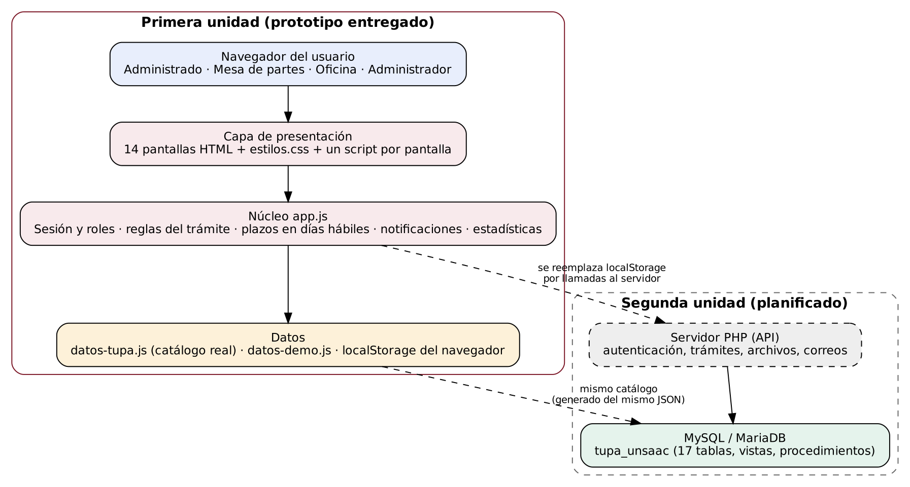

# Arquitectura

Arquitectura por capas. En la primera unidad se entregan la presentación y el núcleo de reglas, con los datos en el navegador; en la segunda unidad el núcleo pasa a un servidor PHP y los datos a MySQL.

| Capa | Archivos | Responsabilidad |
|---|---|---|
| Presentación | `web/*.html`, `web/css/estilos.css`, `web/js/paginas/*.js` | Pantallas, validación de formularios y respuesta a las acciones |
| Núcleo | `web/js/app.js` | Sesión y roles, menú por perfil, estados del trámite, plazos en días hábiles, notificaciones y estadísticas |
| Datos de la aplicación | `web/js/datos-tupa.js`, `web/js/datos-demo.js`, `localStorage` | Catálogo real del TUPA, datos de demostración y estado de la sesión |
| Base de datos | `database/*.sql` | Modelo relacional con las mismas entidades; se conecta en la segunda unidad |
| Herramientas | `database/herramientas/*.py` | Extraen el TUPA del PDF y generan el SQL y el JavaScript del catálogo |
