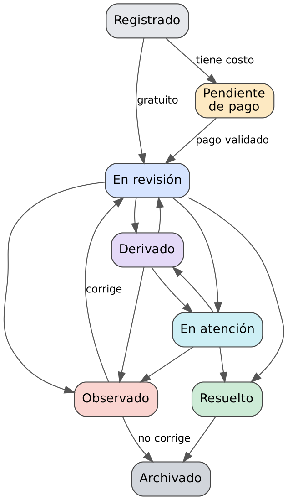

# Fundamentos teóricos aplicados

## Autómata finito de los estados del trámite
A = (Q, Σ, δ, q0, F) determinista.
- Q = {Registrado, Pendiente de pago, En revisión, Observado, Derivado, En atención, Resuelto, Archivado}
- q0 = Registrado; F = {Resuelto, Archivado}
- δ está en `web/js/datos-demo.js` (`transiciones`) y se aplica en `App.cambiarEstado`.

## Lenguajes regulares (validaciones)
DNI `^\d{8}$` · celular `^9\d{8}$` · código `^\d{6}$` · expediente `^\d{4}-\d{6}$` · operación `^\d{4,12}$`.

## Normalización
- 1FN: tarifas y requisitos en tablas propias.
- 2FN: `procedimiento_presentacion` resuelve la relación N:M.
- 3FN: nombre y color del estado en `estados_tramite`; sede de la oficina en `sedes`.

## Plazos en días hábiles
Mientras n > 0: avanzar un día; si no es sábado ni domingo, n = n − 1. Complejidad O(n). Implementado en `sumarHabiles` y en `fn_sumar_dias_habiles`.

## Búsqueda
Filtrado lineal con texto normalizado (NFD, sin tildes ni mayúsculas); índice FULLTEXT en la base de datos.

## Estructuras de datos
Lista ordenada (historial), cola por fecha (bandeja), tabla hash (búsqueda por identificador), agregación en un recorrido (reportes).
